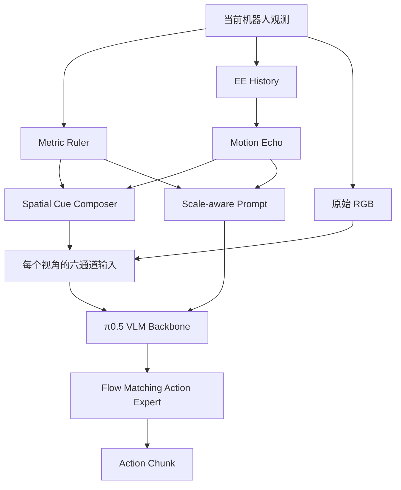

# RulerVLA：研究方法与实验设计

**确定日期：2026-10-24**

**当前标尺定义更新日期：2026-10-26；配置：`configs/metric_ruler.yaml`。**

## 1. 研究目标与核心假设

### 研究问题

现有 Vision-Language-Action（VLA）模型通过 RGB 图像、语言指令和机器人本体状态预测动作，但视觉场景中的空间方向、物理尺度与机器人动作坐标之间的联系仍然需要模型自行学习。

我们重点研究两个问题：

1. **Action Coordinate Grounding**：让 VLA 在视觉输入中感知机器人平移动作坐标系的 XYZ 方向。
2. **Metric Spatial Understanding**：通过真实物理刻度提供尺度参照，帮助 VLA 学习视觉空间与实际运动距离之间的关系。

### 核心假设

**H1：** 在 RGB 之外提供与机器人动作坐标系一致的视觉标尺，有助于模型建立视觉空间与动作方向的对应关系。

**H2：** 带有真实厘米刻度的视觉标尺，有助于模型学习物理尺度，提高未见物体位置和空间距离变化条件下的操作能力。

**H3：** 利用机器人已经发生的真实运动构造历史位移提示，可以为策略提供空间运动反馈，进一步改善操作表现。

三个假设均需要通过受控实验验证。

---

## 2. 方法整体架构

方法由两个视觉组件及一个语言说明机制组成：

- **Component 1：EE-Centric Metric Ruler**
- **Component 2：Proprioceptive Motion Echo**
- **Scale-aware Language Prompt**

使用预训练的 π0.5 作为基础策略，保持原有 Flow Matching 动作训练目标。



机器人视觉输入包含 Agentview 和 Wrist Camera 两个有效视角。

空间提示根据当前机器人本体状态、相机标定和实际历史运动生成。

---

## 3. Component 1：EE-Centric Metric Ruler

### 3.1 坐标定义

采用当前 End-Effector（EE/TCP）位置作为标尺原点：

\[
O_t=p_{\mathrm{EE},t}
\]

标尺的 XYZ 方向与机器人实际平移动作坐标系一致。

在当前 LIBERO 设置下，平移动作参考系为 world XYZ。

每个刻度点的三维位置定义为：

\[
P_{j,k}=p_{\mathrm{EE},t}+k\delta e_j
\]

其中：

- \(j\in\{X,Y,Z\}\)：坐标轴；
- \(k\in\{1,2,3\}\)：正方向刻度索引；
- \(\delta=0.05\,\mathrm m\)：实际物理分度值；
- \(e_j\)：动作坐标系中的单位方向向量。

EE 位置变化时，标尺原点同步更新。XYZ 方向遵循动作坐标系的定义。

每条轴从 EE 原点沿正方向延伸至 15 cm，刻度位于 +5、+10、+15 cm。三个轴分别投影到当前相机视野。

### 3.2 标尺参数

| 参数 | 当前确定值 |
|---|---|
| 原点 | 当前 EE/TCP |
| 坐标系 | Action World XYZ |
| X 轴范围 | 0 cm 至 +15 cm |
| Y 轴范围 | 0 cm 至 +15 cm |
| Z 轴范围 | 0 cm 至 +15 cm |
| 分度值 | 5 cm |
| 刻度样式 | +5、+10、+15 cm 使用等价、等长横刻度 |
| 显示方向 | 仅正 XYZ 轴，采用实线 |
| 轴颜色 | X：红色；Y：绿色；Z：蓝色 |

覆盖范围、分度值与绘图参数由统一配置管理。

当前配置为 `configs/metric_ruler.yaml`，训练与推理输入共用 `configs/metric_workflow.yaml`。标尺采用实线、等价横刻度及 EE 原点。checkpoint 的输入合同通过几何、绘制参数和预处理内容的哈希校验；历史 checkpoint、协议和结果保留各自的冻结定义，正式训练须采用匹配的协议。

### 3.3 三维投影

根据每个相机的内参 \(K\) 和外参 \(T\)，将三维刻度点投影到当前图像：

\[
\tilde p_{\mathrm{image}}
\sim K T_{\mathrm{camera}\leftarrow\mathrm{world}}
\begin{bmatrix}P_{j,k}\\1\end{bmatrix}
\]

Agentview 和 Wrist Camera 分别使用各自的相机参数，投影同一组世界坐标中的刻度点。

要求：

- 保持真实物理刻度间距；
- 正确处理近平面与视野边界；
- 保持 RGB 与空间提示的像素坐标一致；
- 统一处理相机坐标变换、图像翻转与缩放；
- 记录有效刻度、投影间距与可见范围。

在最终 224×224 分辨率下采用抗锯齿绘制。与原点或同轴已绘制刻度的间距不足 6 px、刻度图形跨出视野边界或投影退化时，按 +5、+10、+15 cm 的固定顺序选择可辨识刻度，记录所有被省略的位置和原因。刻度的世界位置及物理间距保持原定义。

Ruler 的三维构造使用 EE 位姿和相机标定。当前方法的在线提示生成不依赖目标检测结果。

---

## 4. 六通道视觉输入

### 4.1 输入定义

对每个相机视角 \(v\)，分别构造：

\[
X_t^{(v)}
=
\operatorname{Concat}
\left(
N(I_t^{(v)}),C_t^{(v)}
\right)
\]

其中：

- \(I_t^{(v)}\)：原始 RGB 图像；
- \(N\)：原 π0.5 使用的 RGB 归一化；
- \(C_t^{(v)}\)：与当前图像像素对应的三通道空间提示。

输入尺寸：

\[
X_t^{(v)}\in\mathbb R^{224\times224\times6}
\]

### 4.2 通道组成

| 通道 | 内容 |
|---|---|
| 0–2 | 当前相机的原始 RGB |
| 3–5 | 当前相机的 Spatial Cue |

空间提示通道采用 RGB 风格的三分量表示：

- 红色分量：X 轴标尺；
- 绿色分量：Y 轴标尺；
- 蓝色分量：Z 轴标尺；
- 黄色视觉元素：启用 Motion Echo 时的历史位移提示。

Spatial Cue 的背景值为 0，编码范围为 `[0,1]`。

原始 RGB 的纹理与颜色信息完整保留，模型输入时按原规范归一化到 `[-1,1]`。

### 4.3 多视角与图像槽

当前 π0.5 运行时保留四个图像槽：

| 图像槽 | 内容 | Image Mask |
|---|---|---|
| `base_0_rgb` | Agentview RGB＋Cue | True |
| `left_wrist_0_rgb` | Wrist RGB＋Cue | True |
| `right_wrist_0_rgb` | 六通道空白输入 | False |
| `aux_wrist_cue_rgb` | 六通道空白输入 | False |

每个图像槽统一采用六通道形状。

两个有效视角分别生成与自身相机参数对应的空间提示。

### 4.4 SigLIP 视觉编码器

将 π0.5 的 SigLIP Patch Embedding 输入通道数从 3 扩展为 6。

原始卷积核：

\[
W_{\mathrm{RGB}}\in
\mathbb R^{14\times14\times3\times1152}
\]

扩展后：

\[
W_{\mathrm{new}}\in
\mathbb R^{14\times14\times6\times1152}
\]

初始化规则：

\[
W_{\mathrm{new}}
=
[W_{\mathrm{RGB}},0]
\]

保留预训练 RGB 权重，新增通道权重初始化为零。

实际前向计算采用：

\[
h=
\operatorname{Conv}(RGB,W_{\mathrm{RGB}})
+
\operatorname{Conv}(Cue,W_{\mathrm{Cue}})
+b
\]

两个计算分支共享同一个六通道参数张量。该实现用于保持旧 RGB 输入路径的数值行为，并允许新增 Cue 权重参与反向传播。

---

## 5. Scale-aware Language Prompt

语言指令由任务文本和空间提示说明组成。

固定 Prompt 示例：

```text
Task: Pick up the black bowl.

Spatial Reference:
Origin: Current end-effector TCP.
Axes: Robot world XYZ.
The auxiliary cue uses red for X, green for Y, and blue for Z.
Only positive robot world X, Y, and Z axes are displayed as solid lines.
Each axis spans 0 cm to +15 cm from the origin.
All ticks are equivalent; each physical interval is 5 cm.
Crowded or clipped ticks may be omitted; visible ticks retain their true physical positions.
```

实现要求：

- 任务指令保留完整；
- 标尺分度值与 Prompt 使用同一配置；
- 明确 EE 原点、动作坐标系、正轴显示和 0～15 cm 范围；
- 训练与推理使用相同的 Prompt Builder；
- 使用实际 PaliGemma Tokenizer；
- 检查最大 Token 长度及截断条件。

Prompt 提供视觉符号的语义和物理单位说明。

---

## 6. Component 2：Proprioceptive Motion Echo

### 6.1 设计目标

利用机器人已经执行的实际运动，在当前视觉输入中提供历史位移参照。

Echo 与 Metric Ruler 使用同一机器人参考系。

### 6.2 历史位移定义

设历史窗口为 \(h\) 个环境控制步：

\[
\Delta p_t=p_{\mathrm{EE},t}-p_{\mathrm{EE},t-h}
\]

默认参数：

\[
h=5
\]

其中：

- \(p_{\mathrm{EE},t}\)：当前实际 EE 位置；
- \(p_{\mathrm{EE},t-h}\)：同一 episode 中过去的 EE 位置；
- \(\Delta p_t\)：该窗口内实际发生的净位移。

历史数据来源于机器人执行后的本体状态。

### 6.3 视觉表达

将过去 EE 位置与当前 EE 位置投影到当前相机：

\[
u_{\mathrm{past}}^{(v)}
=
\pi_t^{(v)}(p_{\mathrm{EE},t-h})
\]

\[
u_{\mathrm{current}}^{(v)}
=
\pi_t^{(v)}(p_{\mathrm{EE},t})
\]

使用黄色线段表达从过去位置到当前位置的实际位移。真实当前 EE 端点可见时，在该点绘制箭头头部；端点位于画面或近平面之外时，只保留经过裁剪的可见线段。OpenCV 在 224×224 标定下进行亚像素抗锯齿，头部长度不超过可见投影长度的 40%。

Agentview 和 Wrist Camera 分别使用当前时刻的相机参数进行投影。

Echo 表达的是过去窗口内的净位移。窗口长度与真实时间间隔应随样本记录。

### 6.4 历史状态管理

训练阶段从同一 episode 内提取历史 EE 状态。

推理阶段维护 `EpisodeHistoryBuffer`：

- 每个控制步记录当前 EE 状态；
- 使用同一 episode 的历史；
- episode reset 时清空历史；
- 历史不足时标记为无效；
- 检查历史索引、当前步骤和观测时间的一致性。

### 6.5 与 Ruler 融合

`Spatial Cue Composer` 负责组合：

1. Metric Ruler Cue；
2. Motion Echo Cue。

两个组件可以独立启用。

Echo 启用时，在原三通道 Spatial Cue 中绘制黄色位移提示。

重叠区域逐通道取最大值：`Cue = maximum(Ruler, Echo)`，各通道强度均不低于原标尺；黄色 Echo 的蓝通道为零，因此 Z 通道逐值保持。重叠处可能出现混合颜色，共享三通道不能分别恢复两个组件。原始 RGB 保持不变。

Echo 对应的 Prompt 说明为：

```text
Motion Echo:
Measured EE displacement over 5 environment control steps.
Agentview: yellow arrow to current EE.
Wrist: yellow arrow to current EE.
Colors mix where cues overlap.
```

Prompt 根据两个视角的实际渲染诊断生成：历史不足时说明没有有效 Echo；净位移小于 3 mm 时说明低于显示阈值；单视角不可见或当前端点被裁剪时分别说明状态。小于 1 px 的投影留空，不移动端点或放大实际位移。

当前方法默认关闭 Echo，独立实验时启用。启用后输入合同保存 `motion_echo_rendering: antialiased_channel_max`；旧 Echo checkpoint 需要对应的冻结源码。正式训练继续服从实验协议与 launch gates。

---

## 7. π0.5 训练方法

### 7.1 基础模型

使用官方预训练 `pi05_base` 权重：

`gs://openpi-assets/checkpoints/pi05_base/params`

模型包括：

- SigLIP 视觉编码器；
- PaliGemma Vision-Language Backbone；
- π0.5 Action Expert；
- Flow Matching 动作生成机制。

### 7.2 训练目标

采用原始 Flow Matching Action Loss：

\[
\mathcal L=\mathcal L_{\mathrm{FM}}
\]

对动作 \(a\) 和噪声 \(\epsilon\)，构造：

\[
a_\tau=(1-\tau)a+\tau\epsilon
\]

目标速度：

\[
u_\tau=\epsilon-a
\]

使用网络预测速度 \(v_\theta\)：

\[
\mathcal L_{\mathrm{FM}}
=
\mathbb E
\left[
\|v_\theta(a_\tau,\tau,o_t)-u_\tau\|_2^2
\right]
\]

其中观测 \(o_t\) 包含六通道视觉输入、任务 Prompt 与机器人本体状态。

模型通过真实专家动作示范学习使用新增视觉提示。

### 7.3 动作数据

使用真实 LIBERO 示范轨迹中的连续动作。

Action Horizon：

\[
H=10
\]

训练中的真实动作块为 `[10,7]`，经原有动作归一化后补齐至模型要求的 `[10,32]`。

动作块按照同一 episode 的时间索引构建。episode 末尾沿用已有的 repeat-last 填充协议。

训练与推理共享几何生成、六通道预处理、Prompt、状态规范化及模型输入定义。

---

## 8. 实验设计

### 8.1 方法消融

所有实验使用相同的六通道模型结构和相同的有效相机视图。

| 组别 | Spatial Cue | Motion Echo | 训练目标 |
|---|---|---|---|
| M0：RGB | 空白 Cue | 关闭 | Flow Matching |
| M1：Direction | 正 XYZ 方向提示 | 关闭 | Flow Matching |
| M2：Metric Ruler | 正 XYZ 轴 0～15 cm 真实米制标尺，每 5 cm 等价刻度 | 关闭 | Flow Matching |
| M3：Metric Ruler＋Echo | 同一正轴米制标尺 | 开启 | Flow Matching |

每组使用统一的：

- 基础 checkpoint；
- 训练数据与样本划分；
- 训练更新次数；
- 优化器与学习率；
- 图像输入数量；
- 动作 Horizon；
- 评测初始状态与随机种子。

M1 的 Direction Cue 需要记录确切实现与参数，便于和 AxisGuide 等相关方法进行公平比较。

### 8.2 LIBERO-Spatial 位置泛化实验

使用 LIBERO-Spatial 中的黑碗操作任务构造空间位置泛化实验。

根据训练示范中目标物体的初始位置分布，确定训练区域和测试区域。

测试区域包含：

1. 训练位置支持区域；
2. 训练位置覆盖范围内的留出位置；
3. 训练位置覆盖范围外的可行位置。

在经过可达性与碰撞检查的桌面区域构建二维测试网格，固定每个网格位置的测试初始条件。

评测相同网格上的多个策略，统计重复 rollout 的成功率。

### 8.3 主要指标

**任务表现：**

- 完整任务成功率；
- 接触成功率；
- 抓取成功率；
- 机器人执行位置误差；
- 失败类型分布。

**空间泛化：**

- 训练区域成功率；
- 内部留出区域成功率；
- 外部留出区域成功率；
- 不同目标距离下的成功率变化；
- 不同相机视角下的成功率变化。

**尺度机制分析：**

- 真实米制标尺与固定像素标尺的比较；
- 保持 RGB 不变时的标尺干预；
- 改变目标位置时的动作响应；
- 动作响应方向与实际空间位移的关系。

输入干预与模型注意力可视化可作为辅助分析。尺度理解的结论综合动作行为、距离变化和任务表现进行判断。

### 8.4 主要图表

**Figure A：Spatial Generalization Map**

展示：

- 训练示范的物体初始位置；
- 测试网格；
- 各方法在不同位置的成功率；
- 训练区域与未见区域的空间边界。

**Figure B：Metric Ruler Mechanism Analysis**

展示：

- 真实米制标尺与像素标尺的差异；
- 不同距离下的策略表现；
- 标尺干预后的动作变化。

**Figure C：Motion Echo Ablation**

展示：

- 纯 Metric Ruler；
- Metric Ruler＋Motion Echo；
- 不同历史运动状态下的实际表现。

---

## 9. 工程实现规范

### 9.1 权威工程

当前开发工作树：

`/home/lixuanyi/XuanyiLi/work/worktrees/rulervla-metric-cue`

Git 分支：

`research/metric-cue-pilot`

RulerVLA 保持单一正式工程，现有历史实验、checkpoint 和冻结运行时继续保留。

### 9.2 模块职责

| 模块 | 职责 |
|---|---|
| `geometry/` | 坐标转换、相机投影与几何计算 |
| `geometry/camera.py` | 相机缩放、像素方向变换及近平面/视野裁剪 |
| `cues/metric_ruler.py` | 真实物理刻度构造与渲染 |
| `cues/motion_echo.py` | 实测历史位移提示 |
| `cues/metric_prompt.py` | 空间提示文字说明 |
| `adapters/metric_cue.py` | 多视角 Cue 与六通道图像 |
| `adapters/metric_pipeline.py` | 统一训练／推理预处理 |
| `training/metric_workflow.py` | 原始动作训练与 checkpoint |
| `src/openpi/` | 六通道 π0.5 视觉编码与动作模型 |

### 9.3 数据与模型约束

- 坐标、单位、相机标定和分度值具有明确的数据定义；
- 训练与推理共享相同的几何及视觉预处理；
- 原始任务指令与当前观测进入模型；
- 真实动作示范进入训练损失；
- Echo 只读取同一 episode 的当前和过去状态；
- 训练、评估分别记录数据来源、配置、checkpoint 和 Git commit；
- 模型恢复检查六通道参数、归一化统计、Tokenizer 和优化器状态；
- 旧实验保留相应的冻结运行时和历史数据。

---

## 10. 当前工程状态（2026-10-26）

| 项目 | 已有状态 |
|---|---|
| EE 原点、正 XYZ 轴 0～15 cm 米制标尺 | 无箭头；真实样本 CPU 渲染与输入核验通过 |
| Agentview 与 Wrist 六通道输入 | 已实现 |
| SigLIP 3→6 通道权重迁移 | G1 CPU 验收通过 |
| 原始 Action Loss 对 Cue 的梯度 | G1 CPU 验收通过 |
| 六通道完整状态保存恢复 | G1 CPU 验收通过 |
| Scale-aware Prompt | 已实现 |
| Motion Echo 渲染与历史管理 | 已实现，默认关闭 |
| 真实连续 Action Chunk | G2 样本验收通过 |
| 统一训练／推理接口 | G2 CPU 输入验收通过 |
| 完整 π0.5 GPU Smoke | 待完成 |
| M0–M3 正式训练 | 待执行 |
| LIBERO 空间泛化评测 | 待执行 |
| 米制尺度学习的有效性 | 待实验验证 |

正式训练发布条件继续关闭，完整模型 GPU 数值、参数更新及恢复验证待完成。已经存在来源哈希经过核验的局部真实数据缓存，用于当前 CPU 渲染及输入核验；该证据不代表完整模型 GPU 训练验收通过。

正式训练和位置泛化实验使用冻结的数据划分、模型配置与评测协议。
